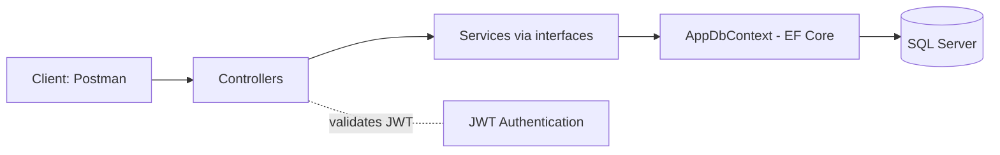
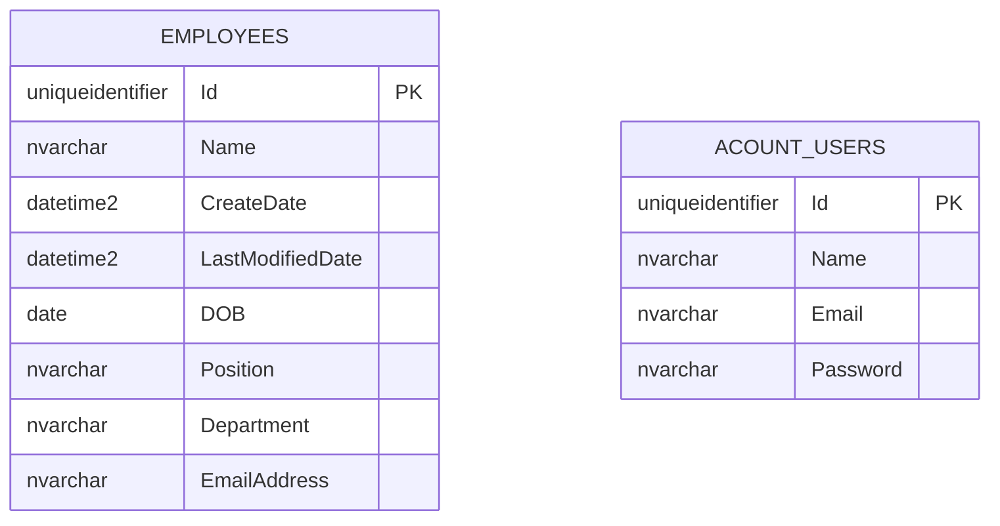

# Employee Management API

A backend REST API built with **ASP.NET Core (.NET 10)** and **C#**. It supports user registration and login with JWT authentication, and secured CRUD operations for employees, using Entity Framework Core and SQL Server.

> **Status:** Work in progress 🚧. Core features are working; validation, tests and more endpoints are still being added.

## Features

- User registration and login
- JWT authentication and authorization
- Employee management: create, read, update, delete
- Entity Framework Core with code-first migrations
- SQL Server / LocalDB integration
- Service layer with interfaces and dependency injection
- DTOs and a generic response wrapper (`ResponseResult<T>`)

## Tech Stack

| Area | Technology |
|---|---|
| Language | C# |
| Framework | ASP.NET Core Web API, .NET 10 |
| ORM | Entity Framework Core |
| Database | SQL Server / LocalDB |
| Authentication | JWT Bearer tokens |
| API testing | Postman |

## System Design

### Architecture



### Request flow

1. The client registers or logs in and receives a JWT.
2. The client sends the token in the `Authorization: Bearer <token>` header.
3. A controller marked `[Authorize]` receives the request and passes DTOs to the service.
4. The service contains the business logic and uses `AppDbContext` to read or write data.
5. The result is wrapped in `ResponseResult<T>` and returned as JSON.

### Project structure

```
Controllers/      HTTP endpoints (Auth, Employee)
Services/         Service implementations
IServices/        Service interfaces (for dependency injection)
Dto/              Request and response models
Entities/         Database entities
Data/             AppDbContext
Migrations/       EF Core migrations
GenericResponse/  Standard response wrapper
sql/              Schema script and example queries
```

### Design decisions

- **Interfaces and dependency injection** keep controllers independent of implementations and make services easy to test.
- **DTOs** keep database entities from being exposed directly to clients.
- **Code-first migrations** keep the database schema versioned together with the code.
- **JWT** keeps the API stateless: each request carries its own proof of identity.

## Database Design

SQL Server database managed with EF Core code-first migrations.

### Entity relationship diagram



### Tables

| Table | Purpose |
|---|---|
| `Employees` | Employee records
