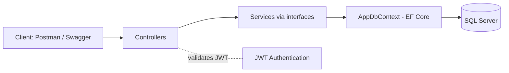
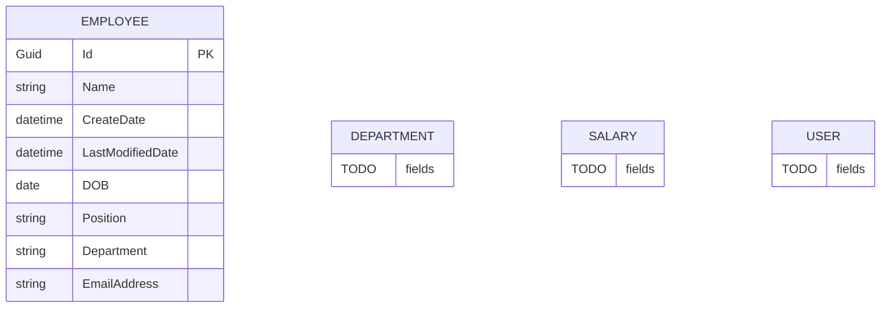

# Employee Management API

A backend REST API built with **ASP.NET Core (.NET 10)** and **C#**. It supports user registration and login with JWT authentication, and secured CRUD operations for employees, backed by Entity Framework Core and SQL Server.

> **Status:** Active development 🚧. Core features work; more endpoints, validation and tests are being added.

## Features

- User registration and login
- JWT authentication and authorization
- Employee management (create, read, update, delete)
- Entity Framework Core with code-first migrations
- SQL Server / LocalDB integration
- Service layer with interfaces and dependency injection
- DTOs and a generic response wrapper (`ResponseResult<T>`)
- Swagger / Postman for API testing

## Tech Stack

| Area | Technology |
|---|---|
| Language | C# |
| Framework | ASP.NET Core Web API, .NET 10 |
| ORM | Entity Framework Core |
| Database | SQL Server / LocalDB |
| Auth | JWT Bearer tokens |
| Testing tools | Swagger, Postman |

## System Design

### Architecture



### Request flow

1. The client calls `POST /api/Auth/...` with credentials and receives a JWT.
2. The client sends the token in the `Authorization: Bearer <token>` header.
3. A controller (marked `[Authorize]`) receives the request and passes DTOs to the service.
4. The service holds the business logic and uses `AppDbContext` to read or write data.
5. The result is wrapped in `ResponseResult<T>` and returned as JSON.

### Project structure

```
Controllers/      HTTP endpoints (Auth, Employee)
Services/         Business logic implementations
IServices/        Service interfaces (for dependency injection)
Dto/              Data transfer objects (request and response models)
Entities/         Database models (Employee, Department, Salary, User)
Data/             AppDbContext
Migrations/       EF Core migrations
GenericResponse/  Standard response wrapper
```

### Design decisions

- **Interfaces + dependency injection** keep controllers independent of implementations and make services easy to test.
- **DTOs** keep database entities from being exposed directly.
- **Code-first migrations** keep the database schema versioned alongside the code.
- TODO: add one line on why you chose JWT.

## Database Design

### Entity relationship diagram



> TODO: fill in the fields for `Department`, `Salary` and `User` from your entity classes, and draw the relationships you have (for example `DEPARTMENT ||--o{ EMPLOYEE : has`).

### Tables

| Table | Purpose |
|---|---|
| Employees | Employee records |
| Departments | TODO |
| Salaries | TODO |
| Users | Login accounts for the API |

### Notes

- Primary keys are `Guid`.
- `Employee.Department` is currently a plain text field. Planned improvement: link it to the `Department` table with a foreign key.
- Schema is managed with EF Core migrations (see `Migrations/`).

## API Endpoints

All Employee endpoints require a valid JWT.

| Method | Endpoint | Description |
|---|---|---|
| GET | `/api/Employee/GetAllEmployees` | List all employees |
| GET | `/api/Employee/GetEmployeeById/{id}` | Get one employee |
| POST | `/api/Employee/CreateEmployee` | Create an employee |
| PUT | `/api/Employee/UpdateEmployee` | Update an employee |
| DELETE | `/api/Employee/DeleteEmployee?id={id}` | Delete an employee |

Auth endpoints (no token needed):

| Method | Endpoint | Description |
|---|---|---|
| POST | TODO (check `AuthController.cs`) | Register a user |
| POST | TODO (check `AuthController.cs`) | Log in and receive a JWT |

## Getting Started

### Prerequisites

- [.NET 10 SDK](https://dotnet.microsoft.com/download)
- SQL Server or SQL Server LocalDB

### Run locally

```bash
git clone https://github.com/affansafi1221-byte/EmployeeManagementAPI.git
cd EmployeeManagementAPI

# set the JWT key (use your own long random value)
dotnet user-secrets set "Jwt:Key" "your-long-random-key"

# create the database
dotnet ef database update

# run
dotnet run
```

Then open Swagger at `https://localhost:<port>/swagger` or use Postman.

> TODO: confirm the exact configuration key names in your `appsettings.json` and update the user-secrets line to match.

## Roadmap

- [ ] Link `Employee` to `Department` with a foreign key
- [ ] Return proper HTTP status codes (404, 400) instead of always 200
- [ ] Input validation
- [ ] Unit tests with xUnit
- [ ] Pagination and search for employees
- [ ] Screenshots of Swagger and sample requests

## Learning Goals

- REST API design
- Authentication and authorization with JWT
- Working with databases using Entity Framework Core
- API testing with Postman

## Notes

This is a learning project and is not production-ready yet.
